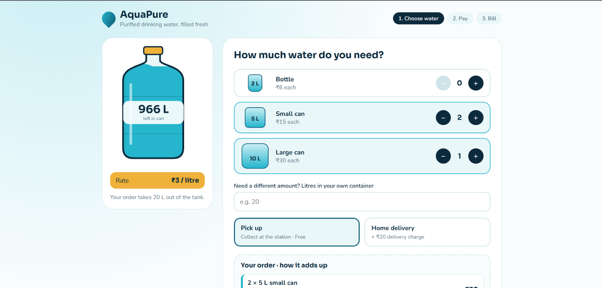
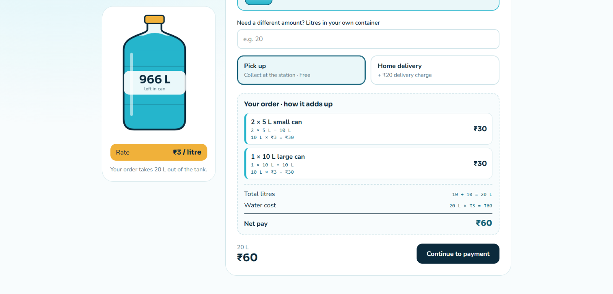
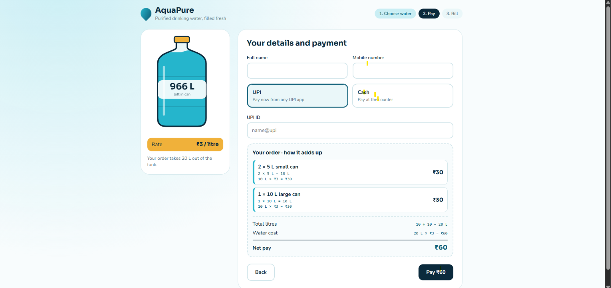
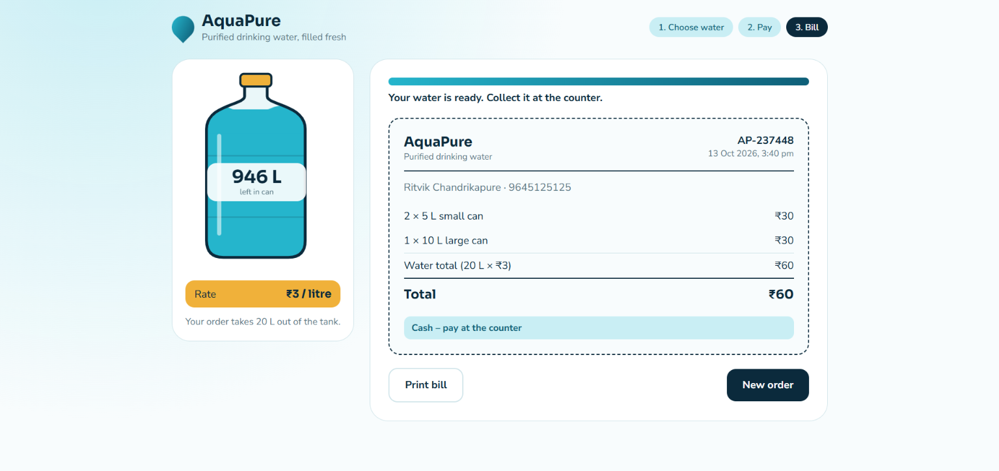

# AquaPure 💧

**AquaPure** is a water ordering interface for choosing water quantities, selecting pickup or home delivery, entering customer/payment details, and viewing a final bill. The interface includes a live tank-level display that updates based on the quantity ordered.

## Screenshots

### 1. Choose water


### 2. Order summary


### 3. Customer details and payment


### 4. Final bill


## Features

- Select water bottles and cans in different sizes.
- Adjust quantities with plus and minus controls.
- Enter a custom quantity in litres.
- Choose pickup or home delivery.
- View a live order summary, litre total, and price calculation.
- Enter customer details and select a payment method.
- View and print the final bill.
- See the tank's remaining water level update with the order.

## Tech Stack

- React
- Vite
- JavaScript / JSX
- CSS

## Run Locally

1. Clone this repository:

   ```bash
   git clone <YOUR_GITHUB_REPOSITORY_URL>
   ```

2. Open the project folder:

   ```bash
   cd aquapure
   ```

3. Install dependencies:

   ```bash
   npm install
   ```

4. Start the development server:

   ```bash
   npm run dev
   ```

5. Open the local URL shown in your terminal (Vite commonly uses `http://localhost:5173`).

## Project Structure

```text
aquapure/
├── src/
│   ├── images/
│   ├── App.jsx
│   ├── App.css
│   └── main.jsx
├── index.html
├── package.json
└── vite.config.js
```

## Notes

- Update `<YOUR_GITHUB_REPOSITORY_URL>` with your repository's clone URL.
- The screenshots above are stored in the repository root so GitHub can display them directly in this README.
